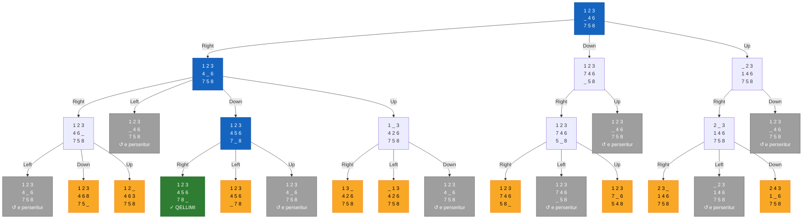
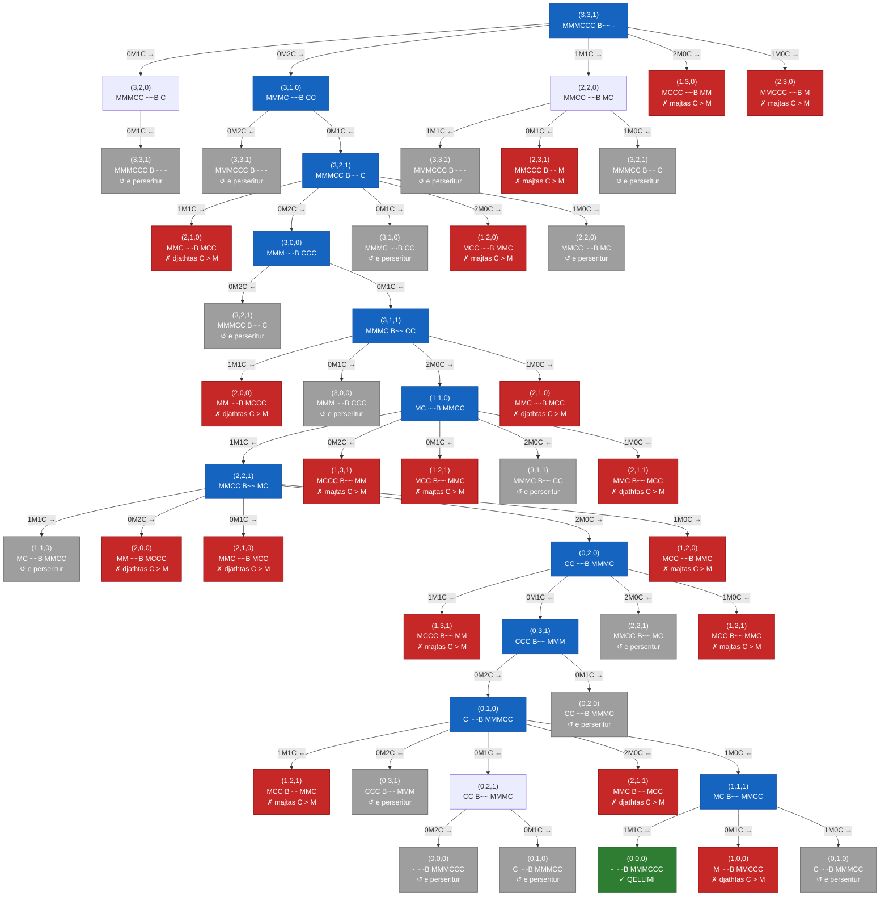
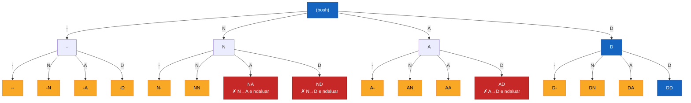

# Detyra 4 – Search Trees

**Përshkrimi:** konstruktimi i Search Tree për problemet **8-Puzzle**, **Missionaries and Cannibals** dhe **Rotating Workforce Scheduling**.

## Si ndërtohet pema

Një **search tree** fillon nga gjendja fillestare, që është rrënja e pemës. Për çdo nyje, gjenerohen fëmijët e saj, një për secilin veprim të mundshëm. Pema ndërtohet **nivel pas niveli** (BFS). Kodi i përbashkët gjendet në [search_tree.py](search_tree.py), ndërsa secili problem ka skedarin e vet me modelin.

Çdo nyje merr një status:

| Statusi | Kuptimi | Ngjyra në diagram |
|---|---|---|
| — | Nyje e zakonshme, zgjerohet | e bardhë |
| `*` | Në rrugën nga rrënja te zgjidhja | blu |
| `GOAL` | Gjendja e qëllimit | jeshile |
| `REPEATED` | Gjendja është parë më parë, prandaj nuk zgjerohet | gri |
| `INVALID` | Gjendja shkel kufizimet, prandaj nuk zgjerohet | e kuqe |
| `LIMIT` | Është arritur thellësia maksimale e vizatimit | e verdhë |

Programi i shtyp pemët si tekst. I ruan gjithashtu në folderin [output/](output/), si `.txt` dhe si `.mmd` (Mermaid). GitHub i vizaton automatikisht diagramet Mermaid më poshtë, dhe ato mund të hapen edhe te [mermaid.live](https://mermaid.live).

---

## 1. 8-Puzzle

### Modelimi

- **Gjendja:** rrjetë 3×3 me pllakat 1–8 dhe një hapësirë bosh (`_`), e ruajtur si tuple me 9 vlera.
- **Gjendja fillestare:** `1 2 3 | _ 4 6 | 7 5 8`.
- **Qëllimi:** `1 2 3 | 4 5 6 | 7 8 _`.
- **Veprimet:** hapësira bosh lëviz **Up**, **Down**, **Left** ose **Right**, nëse nuk del jashtë rrjetës.
- **Faktori i degëzimit:** 2 kur hapësira është në kënd, 3 në buzë dhe 4 në qendër.
- **Gjendjet e përsëritura:** p.sh. lëvizja Up pas Down kthen në gjendjen e mëparshme. Këto shënohen `REPEATED` dhe nuk zgjerohen.

### Pema (thellësia 3)

```
1 2 3 | _ 4 6 | 7 5 8   [*]
├── Up -> _ 2 3 | 1 4 6 | 7 5 8
│   ├── Down -> 1 2 3 | _ 4 6 | 7 5 8   [REPEATED]
│   └── Right -> 2 _ 3 | 1 4 6 | 7 5 8
│       ├── Down -> 2 4 3 | 1 _ 6 | 7 5 8   [LIMIT]
│       ├── Left -> _ 2 3 | 1 4 6 | 7 5 8   [REPEATED]
│       └── Right -> 2 3 _ | 1 4 6 | 7 5 8   [LIMIT]
├── Down -> 1 2 3 | 7 4 6 | _ 5 8
│   ├── Up -> 1 2 3 | _ 4 6 | 7 5 8   [REPEATED]
│   └── Right -> 1 2 3 | 7 4 6 | 5 _ 8
│       ├── Up -> 1 2 3 | 7 _ 6 | 5 4 8   [LIMIT]
│       ├── Left -> 1 2 3 | 7 4 6 | _ 5 8   [REPEATED]
│       └── Right -> 1 2 3 | 7 4 6 | 5 8 _   [LIMIT]
└── Right -> 1 2 3 | 4 _ 6 | 7 5 8   [*]
    ├── Up -> 1 _ 3 | 4 2 6 | 7 5 8
    │   ├── Down -> 1 2 3 | 4 _ 6 | 7 5 8   [REPEATED]
    │   ├── Left -> _ 1 3 | 4 2 6 | 7 5 8   [LIMIT]
    │   └── Right -> 1 3 _ | 4 2 6 | 7 5 8   [LIMIT]
    ├── Down -> 1 2 3 | 4 5 6 | 7 _ 8   [*]
    │   ├── Up -> 1 2 3 | 4 _ 6 | 7 5 8   [REPEATED]
    │   ├── Left -> 1 2 3 | 4 5 6 | _ 7 8   [LIMIT]
    │   └── Right -> 1 2 3 | 4 5 6 | 7 8 _   [*, GOAL]
    ├── Left -> 1 2 3 | _ 4 6 | 7 5 8   [REPEATED]
    └── Right -> 1 2 3 | 4 6 _ | 7 5 8
        ├── Up -> 1 2 _ | 4 6 3 | 7 5 8   [LIMIT]
        ├── Down -> 1 2 3 | 4 6 8 | 7 5 _   [LIMIT]
        └── Left -> 1 2 3 | 4 _ 6 | 7 5 8   [REPEATED]
```

**Pema:** 27 nyje, 9 të zgjeruara, 8 të përsëritura, 9 të ndalura nga kufiri. **Zgjidhja (3 hapa):** Right → Down → Right.



---

## 2. Missionaries and Cannibals

### Modelimi

- **Gjendja:** `(M, C, B)`, ku `M` dhe `C` janë misionarët dhe kanibalët në bregun e majtë, ndërsa `B = 1` do të thotë që varka është majtas.
- **Gjendja fillestare:** `(3, 3, 1)`. **Qëllimi:** `(0, 0, 0)`.
- **Veprimet:** varka bart `(m, c)` ∈ {1M, 2M, 1C, 2C, 1M1C}. Shigjeta `→` tregon nisjen nga e majta, `←` nisjen nga e djathta.
- **Kufizimi:** në asnjë breg kanibalët nuk mund të jenë më shumë se misionarët, kur ka të paktën një misionar atje. Gjendjet që e shkelin shënohen `INVALID`.
- **Gjendjet e përsëritura:** përdoret graph search, pra çdo gjendje zgjerohet vetëm një herë, dhe pema e plotë është e fundme.

### Pema e plotë

```
(3,3,1)  MMMCCC B~~ -   [*]
├── 1M0C → -> (2,3,0)  MMCCC ~~B M   [INVALID: majtas C > M]
├── 2M0C → -> (1,3,0)  MCCC ~~B MM   [INVALID: majtas C > M]
├── 0M1C → -> (3,2,0)  MMMCC ~~B C
│   └── 0M1C ← -> (3,3,1)  MMMCCC B~~ -   [REPEATED]
├── 0M2C → -> (3,1,0)  MMMC ~~B CC   [*]
│   ├── 0M1C ← -> (3,2,1)  MMMCC B~~ C   [*]
│   │   ├── 1M0C → -> (2,2,0)  MMCC ~~B MC   [REPEATED]
│   │   ├── 2M0C → -> (1,2,0)  MCC ~~B MMC   [INVALID: majtas C > M]
│   │   ├── 0M1C → -> (3,1,0)  MMMC ~~B CC   [REPEATED]
│   │   ├── 0M2C → -> (3,0,0)  MMM ~~B CCC   [*]
│   │   │   ├── 0M1C ← -> (3,1,1)  MMMC B~~ CC   [*]
│   │   │   │   ├── 1M0C → -> (2,1,0)  MMC ~~B MCC   [INVALID: djathtas C > M]
│   │   │   │   ├── 2M0C → -> (1,1,0)  MC ~~B MMCC   [*]
│   │   │   │   │   ├── 1M0C ← -> (2,1,1)  MMC B~~ MCC   [INVALID: djathtas C > M]
│   │   │   │   │   ├── 2M0C ← -> (3,1,1)  MMMC B~~ CC   [REPEATED]
│   │   │   │   │   ├── 0M1C ← -> (1,2,1)  MCC B~~ MMC   [INVALID: majtas C > M]
│   │   │   │   │   ├── 0M2C ← -> (1,3,1)  MCCC B~~ MM   [INVALID: majtas C > M]
│   │   │   │   │   └── 1M1C ← -> (2,2,1)  MMCC B~~ MC   [*]
│   │   │   │   │       ├── 1M0C → -> (1,2,0)  MCC ~~B MMC   [INVALID: majtas C > M]
│   │   │   │   │       ├── 2M0C → -> (0,2,0)  CC ~~B MMMC   [*]
│   │   │   │   │       │   ├── 1M0C ← -> (1,2,1)  MCC B~~ MMC   [INVALID: majtas C > M]
│   │   │   │   │       │   ├── 2M0C ← -> (2,2,1)  MMCC B~~ MC   [REPEATED]
│   │   │   │   │       │   ├── 0M1C ← -> (0,3,1)  CCC B~~ MMM   [*]
│   │   │   │   │       │   │   ├── 0M1C → -> (0,2,0)  CC ~~B MMMC   [REPEATED]
│   │   │   │   │       │   │   └── 0M2C → -> (0,1,0)  C ~~B MMMCC   [*]
│   │   │   │   │       │   │       ├── 1M0C ← -> (1,1,1)  MC B~~ MMCC   [*]
│   │   │   │   │       │   │       │   ├── 1M0C → -> (0,1,0)  C ~~B MMMCC   [REPEATED]
│   │   │   │   │       │   │       │   ├── 0M1C → -> (1,0,0)  M ~~B MMCCC   [INVALID: djathtas C > M]
│   │   │   │   │       │   │       │   └── 1M1C → -> (0,0,0)  - ~~B MMMCCC   [*, GOAL]
│   │   │   │   │       │   │       ├── 2M0C ← -> (2,1,1)  MMC B~~ MCC   [INVALID: djathtas C > M]
│   │   │   │   │       │   │       ├── 0M1C ← -> (0,2,1)  CC B~~ MMMC
│   │   │   │   │       │   │       │   ├── 0M1C → -> (0,1,0)  C ~~B MMMCC   [REPEATED]
│   │   │   │   │       │   │       │   └── 0M2C → -> (0,0,0)  - ~~B MMMCCC   [REPEATED]
│   │   │   │   │       │   │       ├── 0M2C ← -> (0,3,1)  CCC B~~ MMM   [REPEATED]
│   │   │   │   │       │   │       └── 1M1C ← -> (1,2,1)  MCC B~~ MMC   [INVALID: majtas C > M]
│   │   │   │   │       │   └── 1M1C ← -> (1,3,1)  MCCC B~~ MM   [INVALID: majtas C > M]
│   │   │   │   │       ├── 0M1C → -> (2,1,0)  MMC ~~B MCC   [INVALID: djathtas C > M]
│   │   │   │   │       ├── 0M2C → -> (2,0,0)  MM ~~B MCCC   [INVALID: djathtas C > M]
│   │   │   │   │       └── 1M1C → -> (1,1,0)  MC ~~B MMCC   [REPEATED]
│   │   │   │   ├── 0M1C → -> (3,0,0)  MMM ~~B CCC   [REPEATED]
│   │   │   │   └── 1M1C → -> (2,0,0)  MM ~~B MCCC   [INVALID: djathtas C > M]
│   │   │   └── 0M2C ← -> (3,2,1)  MMMCC B~~ C   [REPEATED]
│   │   └── 1M1C → -> (2,1,0)  MMC ~~B MCC   [INVALID: djathtas C > M]
│   └── 0M2C ← -> (3,3,1)  MMMCCC B~~ -   [REPEATED]
└── 1M1C → -> (2,2,0)  MMCC ~~B MC
    ├── 1M0C ← -> (3,2,1)  MMMCC B~~ C   [REPEATED]
    ├── 0M1C ← -> (2,3,1)  MMCCC B~~ M   [INVALID: majtas C > M]
    └── 1M1C ← -> (3,3,1)  MMMCCC B~~ -   [REPEATED]
```

**Pema:** 49 nyje, 14 të zgjeruara, 16 të përsëritura, 18 jo-valide. Ka vetëm 15 gjendje valide të arritshme, prandaj pema e plotë është e vogël.

**Zgjidhja (11 hapa, minimale):** 2C → , 1C ← , 2C → , 1C ← , 2M → , 1M1C ← , 2M → , 1C ← , 2C → , 1M ← , 1M1C →



---

## 3. Rotating Workforce Scheduling (RWS)

### Modelimi

`n` punëtorë punojnë sipas të njëjtit **orar ciklik** prej `n` javësh: punëtori `i` në javën `j` ndjek rreshtin `(i + j) mod n` të orarit. Ndërrimet janë: **D** (ditë), **A** (pasdite), **N** (natë) dhe **-** (pushim).

Instanca e përdorur (në [rotating_workforce.py](rotating_workforce.py)):

| Parametri | Vlera |
|---|---|
| Punëtorë / javë në cikël | 4, pra 28 ditë |
| Kërkesa për çdo ditë të javës | 1 D, 1 A, 1 N (dhe 1 pushim) |
| Blloqet e punës (ditë pune radhazi) | 3–6 |
| Blloqet e pushimit | 1–3 |
| Blloqet e të njëjtit ndërrim | 2–5 |
| Sekuenca të ndaluara | N→D, N→A, A→D (pa pushim të mjaftueshëm) |

- **Gjendja:** tuple me ndërrimet e caktuara deri tani (dita 0, 1, 2, …).
- **Gjendja fillestare:** orari bosh `()`.
- **Veprimi:** cakto ndërrimin e ditës së radhës, me domain `{D, A, N, -}`. Degëzimi është 4.
- **Qëllimi:** të 28 ditët janë caktuar dhe të gjitha kufizimet plotësohen, përfshirë kalimin ciklik nga dita 28 te dita 1.
- **INVALID:** sekuencë e ndaluar, më shumë punëtorë se sa kërkohen në një ndërrim, ose bllok shumë i gjatë ose shumë i shkurtër.

### Pema (nivelet e para)

Pema e plotë ka thellësi 28, një nivel për çdo ditë, dhe deri në `4^28 ≈ 7.2·10^16` gjethe. Prandaj vizatohen vetëm nivelet e para:

```
(bosh)   [*]
├── D -> D   [*]
│   ├── D -> DD   [*, LIMIT]
│   ├── A -> DA   [LIMIT]
│   ├── N -> DN   [LIMIT]
│   └── - -> D-   [LIMIT]
├── A -> A
│   ├── D -> AD   [INVALID: A→D e ndaluar]
│   ├── A -> AA   [LIMIT]
│   ├── N -> AN   [LIMIT]
│   └── - -> A-   [LIMIT]
├── N -> N
│   ├── D -> ND   [INVALID: N→D e ndaluar]
│   ├── A -> NA   [INVALID: N→A e ndaluar]
│   ├── N -> NN   [LIMIT]
│   └── - -> N-   [LIMIT]
└── - -> -
    ├── D -> -D   [LIMIT]
    ├── A -> -A   [LIMIT]
    ├── N -> -N   [LIMIT]
    └── - -> --   [LIMIT]
```

Me `python main.py --problem rws --rws-depth 3` (ose më shumë) shfaqen edhe nivele të tjera. Atje dalin edhe arsye të tjera për prerjen e degëve, p.sh. `DAN [INVALID: bllok 'A' < 2]`: ndërrimi A zgjat vetëm një ditë, kurse minimumi është 2.



### Zgjidhja

Zgjidhja u gjet duke ndjekur të njëjtën pemë me **DFS dhe backtracking**: degët `INVALID` priten menjëherë. U zgjeruan vetëm 281 nyje.

```
Java  Hë Ma Më En Pr Sh Di
  1    D  D  D  D  D  -  A
  2    A  A  N  N  -  D  D
  3    N  N  -  -  N  N  N
  4    -  -  A  A  A  A  -
```

Rruga në pemë: `D D D D D - A | A A N N - D D | N N - - N N N | - - A A A A -`. Çdo kolonë (ditë e javës) ka saktësisht një D, një A, një N dhe një pushim.

---

## Ekzekutimi

Kërkohet Python 3.8+ dhe nuk ka nevojë për librari të jashtme.

```bash
cd task4

# Te tre pemet (shtypen dhe ruhen ne output/)
python main.py

# Vetem nje problem
python main.py --problem puzzle --puzzle-depth 4
python main.py --problem mc
python main.py --problem rws --rws-depth 3
```

| Skedari | Përmbajtja |
|---|---|
| [search_tree.py](search_tree.py) | Ndërtimi i pemës, shënimi i rrugës, shtypja si tekst dhe si Mermaid |
| [eight_puzzle.py](eight_puzzle.py) | Modeli i 8-Puzzle |
| [missionaries_cannibals.py](missionaries_cannibals.py) | Modeli i Missionaries and Cannibals |
| [rotating_workforce.py](rotating_workforce.py) | Modeli i RWS dhe zgjidhja me DFS |
| [main.py](main.py) | Ndërton dhe ruan të tri pemët |
| [output/](output/) | Pemët e gjeneruara (`.txt`, `.mmd`) |
